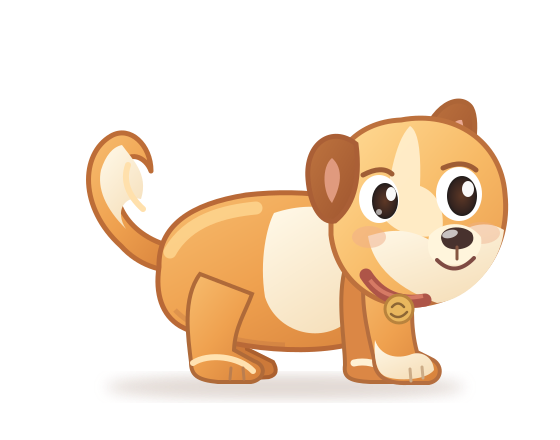

# Puppy 01 — Original Art Foundation

This folder contains **editable, source-authored experimental artwork** for Navin's Pet. It is a starting model study, **not approved final puppy art** and **not animated**.

## Included
- [Original puppy vector rig study](puppy-side-rig.svg): a transparent 560×440 SVG with independently labeled body, legs, head, ears, tail, eyes and mouth groups. Paw contacts are conceptual, not authored gait keyframes.
- [Static art-review page](art-review.html): open locally in a browser to inspect scale and legibility against dark, light or mixed desktop colors. Drag the size slider. Requires no network.
- [Character and motion specification](../../docs/CHARACTER_AND_MOTION.md): required poses, gait constraints and rejection criteria.
- [Reminder performance specification](../../docs/REMINDER_PERFORMANCE.md): complete interaction from pet appearance to exit.

## Still to create
Premium final art; consistent front, side, back and 3/4 turnaround; actual independent animation layers; head/ear/tail follow-through; four authored walking key poses, planted stop, listening/talking, Done, Snooze and authored exit.

**Important:** Separate this original rig study from generated **storyboard inspiration images**, which are visual references but not working rig assets. Do not use previously rejected walking frames.
